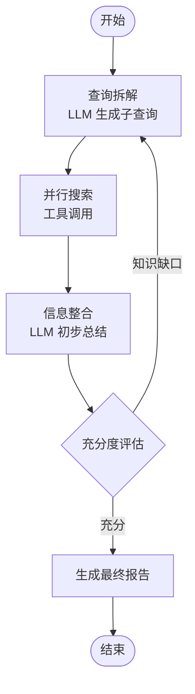

+++
date = '2026-10-04T09:00:00+08:00'
draft = false
title = 'AI Agent 工作流实战：用 LangGraph 编排多步推理与工具调用'
tags = ["AI", "Agent", "LangGraph"]
categories = ['AI 技术笔记']
description = "从 ReAct 到 LangGraph：理解 Agent 的核心抽象（状态、节点、边、循环），掌握多步推理与工具调用的编排方法，以及生产环境必须处理的循环终止、成本控制与错误恢复。"
+++

## Agent 到底解决什么问题

LLM 单次调用是一个「输入 → 输出」的函数。但真实任务往往需要多步：查资料 → 分析 → 再查 → 整理输出。让 LLM 完成这类任务，需要给它**思考与行动交替进行**的能力。

Agent 的经典范式是 **ReAct**（Reasoning + Acting）：

```
思考（Thought）：我需要先搜索 XX 的最新进展
行动（Action）：调用搜索工具，query="XX 最新进展"
观察（Observation）：拿到 5 条搜索结果
思考（Thought）：第 2、3 条相关，但缺少数据支撑，再搜一轮
行动（Action）：调用搜索工具，query="XX 市场份额 数据"
...
最终答案（Final Answer）
```

这个循环的工程实现，就是 Agent 工作流。本文结合我在 AI 深度搜索项目中的实践（见[项目详情](/projects/deep_search/)），梳理 Agent 工作流的核心概念与工程要点。

## LangGraph 的核心抽象

LangGraph 把 Agent 建模成一张**有状态的图**：

| 概念 | 含义 | 类比 |
|------|------|------|
| State | 图流转过程中共享的数据结构 | 工作流里的全局变量 |
| Node | 一个执行单元（调用 LLM、调用工具等） | 流程中的一个步骤 |
| Edge | 节点之间的连接，决定下一步去哪 | 流程线 |
| 条件边（Conditional Edge） | 根据状态动态决定下一步 | if-else |
| 循环（Cycle） | 图允许回到已访问的节点 | while 循环 |

一个典型的「搜索 Agent」图：



关键点：**条件边让「要不要再来一轮」成为 LLM 的决策**，而不是写死的循环次数。

## 工具调用（Function Calling）

工具是 Agent 的手。设计工具时要注意：

1. **工具描述即文档**：LLM 只通过 name/description/schema 理解工具，描述写不好，工具就调不对
2. **参数 schema 要精确**：类型、枚举值、默认值写清楚，减少无效调用
3. **返回结果要「LLM 友好」**：工具返回的内容会被塞进上下文，超长结果要截断或摘要，避免撑爆 context
4. **错误要回传给 LLM**：工具执行失败时，把错误信息作为 Observation 返回，让 LLM 自己决定重试还是换策略

## 生产环境必须处理的四个问题

### 1. 无限循环

LLM 可能永远觉得「信息不够」。两个终止条件缺一不可：

- **最大迭代轮数**：硬上限，防止失控
- **终止判断**：让 LLM 对「当前信息是否足以回答」打分，低于阈值且轮数未超限才继续

### 2. Token 爆炸

每轮循环都会把历史全部塞进下一轮的 context，多轮之后 token 成本指数增长。对策：

- 上下文压缩：把中间结果摘要后再传递，而不是全量拼接
- 控制每轮工具返回长度：截断 + 保留关键信息
- 状态精简：State 里只放必要字段

### 3. 部分失败

多工具并发调用时，部分成功部分失败是常态。需要：

- 每个工具独立容错，失败不影响其他工具结果
- 失败信息结构化返回，让 LLM 知道「哪个工具挂了、错误是什么」

### 4. 可观测性

图里的节点多、分支多，出问题难定位。LangGraph 的调试要点：

- 每个节点记录输入/输出摘要（不必全量，但要能定位）
- 用 checkpointer 持久化状态，支持从任意节点恢复执行
- 图结构保持简单：状态字段越少，排查越容易

## Agent 框架选型思路

| 维度 | 裸 API + 自研循环 | LangChain/LangGraph | 多 Agent 框架 |
|------|-------------------|---------------------|---------------|
| 可控性 | 最高，逻辑全在自己手里 | 高，图结构显式 | 低，框架黑盒多 |
| 开发速度 | 慢，重复造轮子 | 快，内置状态管理与工具抽象 | 最快 |
| 调试难度 | 低（代码直读） | 中 | 高 |
| 适用场景 | 固定流程的任务 | 需要复杂分支/循环的工作流 | 多 Agent 协作实验 |

对面试而言，能讲清楚「为什么用框架、框架帮我解决了什么、框架的边界在哪」比会调用 API 重要得多。

## 一个值得关注的方向：MCP

MCP（Model Context Protocol）是 Anthropic 提出的工具标准化协议，把「工具提供方」和「工具使用方」解耦：工具服务实现 MCP 协议后，任何支持 MCP 的 Agent 都能直接调用，不需要为每个框架重写工具适配。

面试中如果被问到「Agent 工具生态」，可以讲：短期用函数调用解决单应用问题，长期用 MCP 降低多系统集成的成本。

## 小结

- Agent 的核心是「思考-行动」循环，ReAct 是理解它的最小范式
- LangGraph 用图抽象把循环、分支、状态显式化，比黑盒框架更可控
- 生产环境优先处理：终止条件、token 成本、部分失败、可观测性
- 能讲清楚「框架的取舍」是 Agent 面试的加分项

---

**延伸阅读**：

- [AI 深度搜索（项目实战）](/projects/deep_search/)
- [Prompt 工程指南（工具调用的 Prompt 设计）](/posts/ai_notes/prompt_engineering_guide/)
