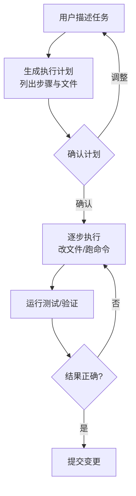

+++
date = '2026-10-05T16:00:00+08:00'
draft = false
title = 'Codex 编程 Agent 实战：从代码补全到自主编程工作流'
tags = ["AI", "Codex", "编程 Agent"]
categories = ['AI 技术笔记']
description = "编程 Agent 的演进路线、Codex CLI 的核心工作流（计划、沙箱执行、回归验证）、AGENTS.md 项目约定如何显著提升生成质量，以及把编程 Agent 用好的工程方法论。"
+++

## 从补全到 Agent：编程 AI 的三级跳

| 阶段 | 能力 | 代表 |
|------|------|------|
| 代码补全 | 预测下一行 | 早期 Copilot |
| 对话式改码 | 理解上下文、按指令修改 | Copilot Chat |
| 编程 Agent | 自主规划任务、执行命令、验证结果 | Codex、Claude Code、各类 IDE Agent |

编程 Agent 的质变是**有了「手」**：不再只是给建议，而是自己跑终端命令、读写文件、跑测试，形成「规划 → 执行 → 验证 → 修正」的闭环。本文以 OpenAI Codex 为例梳理这个工作流的正确用法。

## Codex 的核心工作流

Codex（开源 CLI 工具）的典型交互是「描述任务 → 生成计划 → 分步执行」：



三个关键设计：

1. **计划先行（Plan 模式）**：先输出计划让你审查，避免直接动手改错方向——这是 Agent 可控性的核心
2. **沙箱执行**：终端命令在隔离环境跑，降低「rm 错目录」类事故风险
3. **回归验证**：改完自动跑测试，把「看起来对了」变成「测试真的过了」

## AGENTS.md：给 Agent 的项目说明书

编程 Agent 每次会话都是「新人」，它的表现取决于你喂给它多少项目上下文。`AGENTS.md`（项目根目录的约定文件）就是为此设计的：

```markdown
# AGENTS.md 示例
## 项目概览
Hugo 静态博客，Go Modules 管理主题依赖

## 构建命令
- 开发预览：hugo server
- 生产构建：hugo --minify --cleanDestinationDir

## 编码约定
- 文章 front matter 用 TOML（+++），categories 统一 ['AI 技术笔记']
- 内容文件用 UTF-8 编码
- 不直接改 public/ 目录（构建产物）

## 已知陷阱
- 不要在 PowerShell 里用 && 连接命令，用分号
- hugo.yaml 的分页配置键是 pagination.pagerSize 而非 paginate
```

写好 AGENTS.md 的收益远超想象：**构建命令、编码规范、已知陷阱**这三样能消除大部分低级错误。团队里也可以把它当新人 onboarding 文档维护。

## 把编程 Agent 用好的方法论

1. **任务拆小**：一次只做一件事。「重构整个模块」不如「把 X 函数拆成三个职责单一的函数」
2. **验收标准前置**：描述任务时写清楚「什么算完成」（测试通过、无 lint 错误、构建成功）
3. **让 Agent 先读再写**：要求先阅读相关文件再修改，避免拍脑袋改
4. **人审计划不审代码**：计划阶段介入成本最低，代码逐行审不如让测试兜底
5. **小步提交**：一个任务一个 commit，出错可以精确回退

## 编程 Agent 与 MCP 的结合

编程 Agent 的「手」可以通过 MCP 扩展（见[MCP 协议入门与实战](/posts/ai_notes/mcp_intro_practice/)）：接上数据库、Jira、内部平台后，Agent 能完成「改代码 → 跑集成测试 → 更新工单」的完整链路。这是 2026 年 Agent 生态最活跃的方向之一。

## 面试要点速记

- 编程 AI 演进：补全 → 对话改码 → 自主 Agent，质变在于「能执行命令并验证」
- Codex 工作流核心：计划先行、沙箱执行、回归验证
- AGENTS.md 三要素：构建命令、编码规范、已知陷阱
- 用 Agent 的方法论：任务拆小、验收标准前置、人审计划、小步提交
- Agent + MCP 的组合能力是加分亮点

## 延伸阅读

- [AI Agent 工作流实战：用 LangGraph 编排多步推理与工具调用](/posts/ai_notes/agent_workflow_langgraph/)
- [MCP 协议入门与实战：给 AI 应用接上标准化的插头](/posts/ai_notes/mcp_intro_practice/)
- [Git 快速上手：原理、命令与底层实现](/posts/ai_notes/git_note/)
