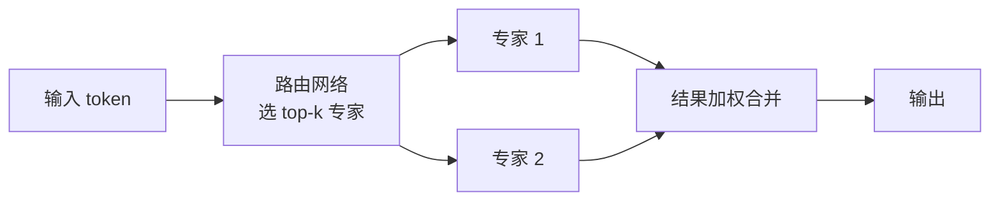

+++
date = '2026-10-05T15:00:00+08:00'
draft = false
title = 'DeepSeek 模型应用实战：推理模型、MoE 与工程取舍'
tags = ["AI", "DeepSeek", "推理模型"]
categories = ['AI 技术笔记']
description = "DeepSeek 系列怎么用在真实项目里：V3 的 MoE 架构为什么便宜、R1 推理模型的思维链特性和工程影响、OpenAI 兼容 API 的接入与切换、本地部署方案，以及什么时候该选 DeepSeek 而不是闭源模型。"
+++

## DeepSeek 系列到底有哪些模型

面试聊「用过 DeepSeek 吗」时，先分清谱系：

| 模型 | 类型 | 特点 |
|------|------|------|
| DeepSeek-V2 | 稠密 → MLA 架构起点 | 提出 MLA 压缩 KV Cache |
| DeepSeek-V3 | MoE 混合专家 | 671B 总参数、37B 激活，训练成本显著低于同规模稠密模型 |
| DeepSeek-R1 | 推理模型 | 强化学习 + 长思维链，数学/代码能力跃升 |
| R1-Distill 系列 | 蒸馏小模型 | 用 R1 输出蒸馏 Qwen/Llama 小模型，能力大幅提升 |

两条主线：**V 系列做「通用性价比」**（便宜、快、够用），**R 系列做「深度推理」**（慢、贵、但难题强）。选型第一问永远是：这个任务需要深度推理吗？

## MoE：V3 为什么这么便宜

V3 是 MoE（混合专家）架构，671B 总参数里每次推理只激活约 37B：



- **训练省**：所有专家共享数据，但每次只激活一部分，训练 FLOPs 远低于同规模稠密模型
- **推理省**：显存装全部专家，但计算量只按激活参数算，速度快
- **代价**：专家路由有训练不稳定的问题（负载不均衡、专家坍塌），工程上需要辅助损失约束

面试表述要点：MoE 是「用显存换计算」——参数全存，计算只做一部分。

## R1 推理模型：思维链是特性也是负担

R1 类推理模型的核心变化：**模型会先「思考」再回答**，输出里带一段推理过程。

工程影响：

1. **响应变慢、token 变多**：同样的问题，输出长度是普通模型的数倍，成本和延迟都上升
2. **thinking 和 answer 分离**：API 返回里推理内容（reasoning_content）和最终答案（content）是分开的字段，**业务逻辑只消费 content**
3. **思维链要单独管理**：多轮对话中历史 reasoning_content 占大量上下文，存储和转发都要处理
4. **不需要推理的任务别用 R1**：查库存、改文案这类任务用 V 系列更快更便宜

```python
# OpenAI 兼容接口调用 deepseek-reasoner
from openai import OpenAI

client = OpenAI(
    api_key="sk-xxx",
    base_url="https://api.deepseek.com"
)

resp = client.chat.completions.create(
    model="deepseek-reasoner",  # 推理模型
    messages=[{"role": "user", "content": "9.11 和 9.9 哪个大？"}]
)

msg = resp.choices[0].message
print("推理过程:", msg.reasoning_content)
print("最终答案:", msg.content)
```

## OpenAI 兼容：接入成本几乎为零

DeepSeek API 与 OpenAI 接口兼容，切换往往只改两行：`base_url` 和 `model`。这意味着：

- 现有基于 OpenAI SDK 的应用可以低成本试跑 DeepSeek
- **A/B 对比很方便**：同一套代码分别打两个端点，用评估流水线（见[LLM 应用评估体系](/posts/ai_notes/llm_evaluation_system/)）对比效果和成本
- 多供应商策略落地容易：主模型 + 降级模型切换只改配置

## 本地部署：Ollama 一条命令

需要数据不出内网、或离线环境时：

```bash
# Ollama 拉取蒸馏小模型
ollama pull deepseek-r1:7b
ollama pull deepseek-r1:14b

# 本地推理
ollama run deepseek-r1:14b "解释一下 MoE 架构"
```

选型建议：本地部署选 **R1-Distill 系列**（7B/14B/32B 蒸馏模型），单卡就能跑，能力明显强于同尺寸通用模型。完整版 R1（671B）本地部署需要多卡 + 量化，个人和小团队不划算。

## 什么时候选 DeepSeek

| 场景 | 建议 |
|------|------|
| 大批量文本处理（分类、抽取、改写） | V3：便宜够用 |
| 数学、代码、复杂逻辑推理 | R1：能力优先 |
| 对数据合规要求高的内网场景 | 本地蒸馏模型 |
| 需要最强通用能力 + 多模态 | 看闭源旗舰 |
| 高频小任务（实时客服） | 蒸馏小模型，延迟优先 |

核心决策逻辑：**按任务难度选推理档位，按数据合规选部署位置，按流量选模型大小**。

## 面试要点速记

- MoE 本质：「用显存换计算」，激活参数远小于总参数
- R1 的工程影响：thinking/answer 分离、成本上升、多轮上下文管理
- OpenAI 兼容让迁移和 A/B 测试成本极低
- 本地部署选蒸馏小模型而非完整版
- 选型逻辑：任务难度 → 推理档位；合规 → 部署位置；流量 → 模型大小

## 延伸阅读

- [模型评测实战：用 lm-evaluation-harness 跑通 Benchmark](/posts/ai_notes/lm_eval_harness_practice/)
- [大模型微调实战：LoRA 与 QLoRA 的原理、流程与踩坑](/posts/ai_notes/lora_finetuning_practice/)
- [LLM 应用评估体系：从评测集设计到 LLM-as-a-Judge](/posts/ai_notes/llm_evaluation_system/)
