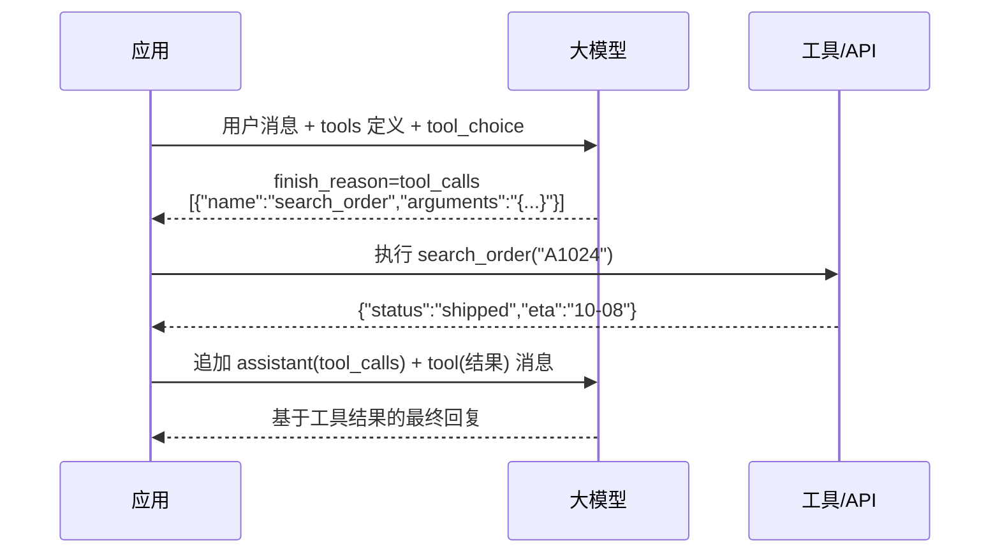

+++
date = '2026-10-05T11:00:00+08:00'
draft = false
title = 'Function Calling 与结构化输出实战：让 LLM 的输出可编程'
tags = ["AI", "Function Calling", "结构化输出"]
categories = ['AI 技术笔记']
description = "从工具调用协议到 JSON Schema 约束解码：tool_calls 消息轮次、strict mode、并行调用、流式处理、错误重试，以及让 Rasa 电商助手稳定返回结构化数据的关键手段。"
+++

## 为什么需要 Function Calling

LLM 原生输出是自由文本。但应用要的是**可编程的结构**：意图分类结果、要调用的工具、要写入数据库的字段。靠 prompt 手写「请输出 JSON」有两个致命问题：格式不稳定、字段会自己发挥。Function Calling（工具调用）让模型学会输出**约定格式的工具调用指令**，而不是自由发挥。

本文结合 Rasa 电商助手项目（见[项目详情](/projects/rasa_ecommerce_assistant/)）中「意图识别 + 槽位抽取 + 工具调用」的实践，梳理 Function Calling 的核心机制与工程要点。

## 一次工具调用的完整消息轮次

Function Calling 不是单次请求，而是一个**消息循环**：



三个容易踩坑的点：

1. **消息角色必须严格**：工具结果要用 `role: "tool"` 回填，并带上对应的 `tool_call_id`，顺序不能乱
2. **模型可能一次返回多个 tool_calls**：要支持并行执行，全部结果一起回填
3. **循环要有终止条件**：最多 N 轮、超时、无新工具调用等兜底，防止死循环

## 参数 Schema：工具描述就是文档

模型只通过 `name / description / parameters` 理解工具。Schema 写得好坏直接决定调用准确率：

```json
{
  "name": "search_products",
  "description": "在商品库中搜索商品。当用户询问商品价格、库存、规格时使用。",
  "parameters": {
    "type": "object",
    "properties": {
      "keyword": {"type": "string", "description": "商品名称关键词，如'蓝牙耳机'"},
      "max_price": {"type": "number", "description": "价格上限，单位元。用户未提则省略"},
      "in_stock": {"type": "boolean", "description": "是否只看有货商品"}
    },
    "required": ["keyword"]
  }
}
```

工程建议：**description 写「什么时候用」而不是「是什么」**；可选参数明确「用户未提则省略」，否则模型会编造默认值。

## 结构化输出：让格式 100% 可控

工具调用解决「调用什么」，结构化输出解决「返回什么格式」。两条路线：

| 方案 | 原理 | 适用场景 |
|------|------|---------|
| JSON Schema 约束（strict mode） | 生成时按 schema 约束 token，保证结构合法 | OpenAI / 主流 API 支持 |
| 约束解码（Grammar/CFG） | 用有限状态机限制生成路径 | 本地部署、vLLM/llama.cpp 生态 |
| Pydantic 校验 + 重试 | 生成后校验，失败重新生成 | 兜底方案，任何模型可用 |

```python
# 结构化输出示例：情感分析结果
from openai import OpenAI
client = OpenAI()

resp = client.chat.completions.create(
    model="gpt-4o",
    messages=[{"role": "user", "content": "物流太慢了，两天了还没发货！"}],
    response_format={
        "type": "json_schema",
        "json_schema": {
            "name": "sentiment",
            "schema": {
                "type": "object",
                "properties": {
                    "sentiment": {"type": "string", "enum": ["positive", "negative", "neutral"]},
                    "aspect": {"type": "string", "description": "投诉针对的环节"},
                    "intensity": {"type": "integer", "minimum": 1, "maximum": 5}
                },
                "required": ["sentiment", "aspect", "intensity"],
                "additionalProperties": False
            }
        }
    }
)
print(resp.choices[0].message.content)
# {"sentiment":"negative","aspect":"物流","intensity":4}
```

`additionalProperties: false` 很关键：禁止模型添加 schema 之外的字段。

## 流式输出中的工具调用

流式场景（SSE）下工具调用不是一次性返回的，而是分片到达。要点：

- `tool_calls` 的 `arguments` 是**增量拼接**的 JSON 字符串，需要客户端累积
- `finish_reason` 为 `tool_calls` 时才开始执行工具，避免用半截参数
- 执行工具期间可以发「正在查询...」的中间状态，防止用户干等

## 错误处理与降级策略

| 故障 | 处理 |
|------|------|
| 参数缺失/非法 | 把错误信息回填给模型，让它修正后重试一次 |
| 工具超时 | 超时 3s 返回「查询超时」，让模型决定换工具还是告知用户 |
| 幻觉调用（工具不存在） | 回填「没有这个工具，可用工具：...」 |
| 模型连续失败 2 次 | 降级为直接文本回复 + 引导转人工 |

一个实用原则：**把工具执行结果当作文档喂给模型**，模型天然具备「根据结果修正行为」的能力，错误回填本身就是一种 few-shot 纠错。

## 面试要点速记

- 工具调用的消息轮次：user → assistant(tool_calls) → tool → assistant(最终回复)
- Schema 描述决定调用准确率：「什么时候用」+「参数边界」
- 结构化输出的三种方案及优劣：strict mode / 约束解码 / 校验重试
- 流式下 tool_calls 增量拼接、finish_reason 触发执行
- 错误回填让模型自我纠错，比代码里写死重试逻辑更自然

## 延伸阅读

- [AI Agent 工作流实战：用 LangGraph 编排多步推理与工具调用](/posts/ai_notes/agent_workflow_langgraph/)
- [Prompt Engineering 实战指南](/posts/ai_notes/prompt_engineering_guide/)
- [Rasa 电商智能客服助手](/projects/rasa_ecommerce_assistant/)
