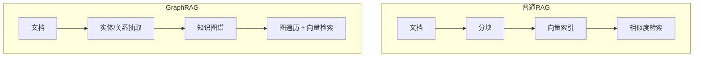

+++
date = '2026-10-05T12:00:00+08:00'
draft = false
title = 'GraphRAG 与知识图谱增强检索：让 RAG 看得见关系'
tags = ["AI", "GraphRAG", "知识图谱"]
categories = ['AI 技术笔记']
description = "普通 RAG 回答不了「A 和 B 什么关系」这类多跳问题：GraphRAG 的思路、知识图谱构建流水线（实体/关系抽取、消歧、Neo4j 存储）、微软 GraphRAG 与 LightRAG 的差异，以及落地时的成本权衡。"
+++

## 普通 RAG 的盲区：关系型问题

向量检索擅长「找相似的段落」，但回答不了需要**跨文档推理**的问题：

- 「张三的上级和采购部负责人是同一个人吗？」——答案散在多份文档里，没有一段文字直接包含
- 「今年哪个部门预算超支最多，超支原因和哪些项目有关？」——需要聚合多个实体再推理

这类「多跳问题」是普通 RAG 的短板。GraphRAG 的思路是：**先把文档里的实体和关系抽出来建成图，检索时顺着边找答案**。本文结合深度搜索项目（见[项目详情](/projects/deep_search/)）中信息聚合的实践，梳理 GraphRAG 的核心方法与工程取舍。

## 核心思想：从「文档索引」到「知识图谱索引」



两种索引回答的问题类型不同：向量索引回答「哪段话相似」，图索引回答「谁和谁有关系、什么关系」。

## 知识图谱构建流水线

构建是 GraphRAG 成本最高的一步：

| 步骤 | 做什么 | 关键难点 |
|------|--------|---------|
| 实体抽取 | LLM 从文本中识别实体（人名、部门、产品...） | 抽取粒度不一致 |
| 关系抽取 | 识别实体间的关系类型（任职、采购、依赖...） | 关系类型失控膨胀 |
| 实体消歧 | 合并同一实体的不同叫法（张三/张总/zhangsan） | 别名与指代 |
| 入库 | 写入图数据库（Neo4j 等） | 增量更新 |

工程实践建议：

- **实体和关系类型用预定义 schema 约束**，让 LLM 从固定类型里选，而不是自由发挥——否则 100 份文档能抽出 80 种关系类型
- **抽取批次要小**：一次 1~2 个 chunk，抽取质量明显高于整篇文档
- **消歧单独跑一轮**：抽取后把候选实体对交给 LLM 判断是否同一实体，比抽取时顺带做更可靠

```cypher
// Neo4j 中一个典型查询：找出与"采购部"直接或间接相关的人
MATCH (p:Person)-[r*1..2]-(d:Department {name: "采购部"})
RETURN p.name, type(r), d.name
LIMIT 20
```

## 两种主流方案：微软 GraphRAG vs LightRAG

| 维度 | 微软 GraphRAG | LightRAG |
|------|--------------|----------|
| 图结构 | 实体-关系图 + **社区层次**（Leiden 算法聚类） | 实体-关系图（轻量双层） |
| 全局问题 | 社区摘要：回答「整体情况如何」类问题 | 高低层关键词检索 |
| 索引成本 | 高（社区检测 + 多级摘要） | 低（单次抽取） |
| 查询方式 | Local Search（局部）/ Global Search（全局） | 图检索 + 向量检索混合 |
| 适用场景 | 大规模语料、需要宏观总结 | 中小规模、追求性价比 |

核心区分点：微软方案多了一层**社区摘要**——把关系紧密的实体聚成社区，为每个社区生成摘要。问「整体情况」时不用遍历全部文档，直接查社区摘要。这是它回答全局问题的关键。

## 查询侧：Text2Cypher 与混合检索

图谱建好后，查询有两条路：

1. **Text2Cypher**：LLM 把自然语言翻译成 Cypher 查询语句，直接查图数据库
2. **图向量混合**：先从向量索引召回种子实体，再沿图遍历扩展上下文

```python
# Text2Cypher 示意：LLM 生成查询 + 模板校验
system = """把用户问题翻译成 Neo4j Cypher 查询。
只允许使用这些关系类型：任职、采购、依赖、审批。
禁止 DELETE / DETACH 等写操作。"""

# 拿到 LLM 生成的 cypher 后必须校验白名单：
ALLOWED = {"MATCH", "RETURN", "WHERE", "LIMIT", "ORDER BY"}
```

Text2Cypher 的风险是模型生成语法错误或危险语句，**必须加白名单校验和只读权限**。

## 生产安全边界：白名单不是字符串匹配

只检查 `DELETE` 等关键词不够：注释、大小写、过程调用和组合语句都可能绕过简单过滤。更稳妥的防线应当分层：

1. **数据库身份只读**：应用使用独立 Neo4j 账号，只授予目标图的读取权限。
2. **查询结构校验**：解析 Cypher AST，仅允许 `MATCH / OPTIONAL MATCH / WHERE / WITH / RETURN / ORDER BY / LIMIT` 等读取子句。
3. **资源上限**：强制超时、最大返回行数和最大遍历深度，避免全图扫描拖垮数据库。
4. **危险能力禁用**：禁止 `CALL`、APOC 写过程、动态标签及多语句执行。
5. **执行前检查**：先运行 `EXPLAIN`，拒绝笛卡尔积、无界变长路径等高风险执行计划。
6. **审计与脱敏**：记录查询模板和耗时，不记录原始敏感问题或完整结果。

```python
READ_ONLY_CLAUSES = {
    "MATCH", "OPTIONAL MATCH", "WHERE", "WITH",
    "RETURN", "ORDER BY", "SKIP", "LIMIT"
}

async def safe_graph_query(question: str):
    cypher, params = await generate_structured_query(question)
    ast = parse_cypher(cypher)
    validate_read_only(ast, allowed=READ_ONLY_CLAUSES)
    validate_limits(ast, max_hops=3, max_rows=100)
    await explain_and_reject_expensive_plan(cypher, params)
    return await readonly_driver.execute_query(
        cypher, parameters_=params, timeout=2.0
    )
```

参数值必须通过 driver 参数绑定传入，不能直接拼接用户文本。即使 LLM 生成了合法只读查询，应用层仍需执行独立校验。

## 可复现实验：普通 RAG 与 GraphRAG 怎么比

GraphRAG 是否值得引入，不能只看案例演示。建议准备一套脱敏小型语料，并将问题按推理类型分层：

| 问题类型 | 示例 | 主要观察指标 |
|----------|------|--------------|
| 单跳事实 | 某制度的审批阈值是什么 | Recall@K、答案正确率、延迟 |
| 两跳关系 | 负责人所属部门参与了哪些项目 | 多跳命中率、Faithfulness |
| 全局归纳 | 哪类风险在多个项目中反复出现 | 要点覆盖率、来源覆盖率 |
| 不可回答 | 语料中不存在的人员关系 | 拒答准确率、幻觉率 |

实验必须固定文档版本、Embedding、生成模型、Prompt、Top-K 和硬件环境。至少对比三组：

- Baseline A：纯向量检索；
- Baseline B：向量检索 + Reranker；
- GraphRAG：向量召回种子实体 + 限深图遍历 + Reranker。

结果文件应逐题保存 `question / expected_facts / retrieved_sources / answer / latency / token_usage`，再聚合以下指标：

```text
检索：Recall@K、MRR、多跳证据完整率
生成：Faithfulness、关键事实覆盖率、拒答准确率
工程：索引耗时、索引成本、P50/P95 查询延迟、单次查询成本
```

当前文章不填写未经运行验证的数字。完成实验后，应同时公开数据生成规则、配置和逐题结果，而不只展示平均分。

## 失败样例应怎样分析

- **实体消歧错误**：同名人员被合并，图遍历得到逻辑正确但事实错误的路径；需要实体 ID、来源证据和人工复核队列。
- **关系抽取遗漏**：图中缺边导致多跳证据不完整；应回溯到原始 chunk，区分抽取失败和语料缺失。
- **路径扩散**：热门实体连接过多，扩展结果噪声迅速上升；需限制关系类型、深度和每层分支数。
- **数据过期**：图和向量索引更新不同步；需统一版本号，在回答中携带来源时间。

## 落地时的成本权衡：别一上来就全量建图

GraphRAG 不是普通 RAG 的替代品，而是补充：

| 场景 | 更合适的方案 |
|------|-------------|
| 单文档内查找事实 | 普通向量 RAG 就够 |
| 跨文档关系推理（多跳） | GraphRAG |
| 宏观趋势/整体总结 | GraphRAG 的社区摘要 |
| 高频更新的语料 | 普通 RAG（图重建成本高） |

务实路线：**向量 RAG 打底，对明确存在多跳查询的业务（如组织架构、供应链、合同关联）再上图谱**。增量更新、抽取质量监控是持续成本，先在小语料上验证查询收益。

## 面试要点速记

- GraphRAG 解决的核心问题：多跳推理与全局总结，向量检索的盲区
- 构建流水线四步：实体抽取 → 关系抽取 → 消歧 → 入库
- 微软 GraphRAG 的社区摘要机制是回答全局问题的关键
- Text2Cypher 必须白名单校验 + 只读权限
- 成本意识：不是所有场景都需要图谱，先验证多跳查询的收益

## 延伸阅读

- [RAG 优化实战：从「能跑」到「能用」的系统调优路线图](/posts/ai_notes/rag_optimization_in_practice/)
- [向量数据库选型与实践](/posts/ai_notes/vector_db_comparisons/)
- [AI 深度搜索项目](/projects/deep_search/)
