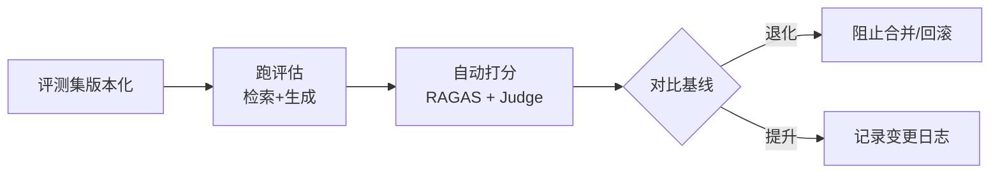

+++
date = '2026-10-05T10:00:00+08:00'
draft = false
title = 'LLM 应用评估体系：从评测集设计到 LLM-as-a-Judge'
tags = ["AI", "评估", "RAGAS"]
categories = ['AI 技术笔记']
description = "面试必问的「你怎么评估你的 RAG 效果」怎么答：分层评估框架、黄金评测集设计、RAGAS 四指标、LLM-as-a-Judge 的偏置与校准，以及把评估做成流水线的工程方法。"
+++

## 为什么「评估」是 LLM 应用的第一难题

传统软件有明确的正确输出，单元测试一跑就知道对不对。LLM 应用没有：同一个问题，两个答案可能都好，也可能都烂。没有评估体系，你改了一个 prompt、换了一个模型，**根本不知道是变好了还是变坏了**——这是 LLM 应用上线前最该先建的能力。

面试中「你怎么评估 RAG 系统的效果」几乎是必问题。本文结合我在知识库 RAG 项目中的实践（见[项目详情](/projects/knowledge_base_rag/)），梳理一套可落地的评估体系。

## 分层：先分清你在评估什么

| 层级 | 评估对象 | 典型指标 | 工具 |
|------|---------|---------|------|
| 模型层 | 基座模型本身的能力 | MMLU、GSM8K、C-Eval | lm-evaluation-harness |
| 组件层 | 检索、重排、意图识别等单模块 | Recall@K、MRR、F1 | 自建脚本 / RAGAS 部分指标 |
| 应用层 | 端到端问答质量 | 忠实度、相关性、任务成功率 | RAGAS、LLM-as-a-Judge |
| 在线层 | 真实用户的反馈 | 点赞/点踩、重问率、采纳率 | 埋点 + 人工抽检 |

关键认知：**模型 benchmark 高分 ≠ 你的应用效果好**。MMLU 考的是知识记忆，你的 RAG 考的是检索+生成配合，两层评估缺一不可。

## 黄金评测集：评估的地基

评测集的质量决定评估的可信度。设计要点：

1. **问题来自真实分布**：从日志、工单、用户咨询里采样，而不是拍脑袋写「什么是机器学习」
2. **分层覆盖**：按意图/难度/文档范围分层抽样，保证每个类型都有样本
3. **规模务实**：50~200 条起步，每条人工标注标准答案和关键要点
4. **关键要点式标注**：不要求逐字匹配，标注「答案必须包含 XX 事实、不得包含 XX」，让自动评判有依据
5. **答案可溯源**：标注答案对应的文档位置，才能单独评估检索环节

```python
# 评测集最小结构示例
{
    "id": "qa_001",
    "question": "报销流程中超过 5000 元需要什么审批？",
    "gold_answer": "需要部门经理 + 财务总监两级审批",
    "key_points": ["两级审批", "5000 元阈值"],
    "source_doc": "docs/报销制度.md",
    "category": "制度咨询",
    "difficulty": "easy"
}
```

## RAG 评估：RAGAS 四指标

RAG 的失败有两类：**检索错了**（拿错文档）和**生成错了**（拿对文档但瞎编）。RAGAS 用四个指标分开定位：

| 指标 | 评估什么 | 含义 |
|------|---------|------|
| Context Precision | 检索回来的上下文里，相关文档排得靠不靠前 | 高了说明检索排序好 |
| Context Recall | 标准答案需要的文档，检索找回了多少 | 低了说明检索漏召回 |
| Faithfulness | 生成答案是否忠实于检索到的上下文 | 低了说明在幻觉 |
| Answer Relevancy | 答案是否切题、无废话 | 低了说明生成跑偏 |

排查链路非常清晰：**Faithfulness 低 → 看 prompt 和生成；Context Recall 低 → 看分块和召回策略；两个都低 → 检索先重建**。

## LLM-as-a-Judge：用大模型评大模型

人工标注太慢，用强模型（如 GPT 系列）当评委是当前主流做法。写 judge prompt 的核心是把判断「客观化」：

```text
你是一名严格的评估员。根据以下标准给候选答案打分（0-5 分）：
1. 忠实性：答案内容是否全部能在【参考材料】中找到依据？
   出现参考材料中没有的断言，扣 2 分/处
2. 完整性：是否覆盖【关键要点】中的所有点？每缺 1 点扣 1 分
3. 简洁性：是否包含无关信息？

【关键要点】
- 两级审批
- 5000 元阈值

【参考材料】
{context}

【候选答案】
{answer}

请给出各维度分数和扣分理由。
```

三个必须知道的偏置：

| 偏置 | 现象 | 缓解方法 |
|------|------|---------|
| 位置偏置 | 同样内容换位置，分数会变 | 多次交换顺序取平均 |
| 自我偏好 | 模型倾向给自己的输出打高分 | 用不同厂商模型交叉评判 |
| 长度偏置 | 长答案容易得高分 | 明确惩罚冗余，或单独评简洁性 |

## 把评估做成流水线

评估不是一次性的活动，而是每次变更的「守门员」：



工程要点：
- **评测集进 git**，和代码一起版本管理
- **基线分数固定**：改 prompt 前先跑一遍记录基线，改完对比
- **定期人工抽检 5%**，校准 judge 分数与人工判断的一致性
- **回归优先于新增**：评估先保证不退化，再谈提升

## 面试要点速记

- 评估体系四层：模型层 / 组件层 / 应用层 / 在线层
- RAGAS 四指标各对应哪个环节的失败
- LLM-as-a-Judge 的三大偏置及缓解
- 「没有评估的优化都是玄学」——评估流水线是 AI 应用工程师的核心工程能力

## 延伸阅读

- [RAG 系统设计与优化实践](/posts/ai_notes/rag_design_and_optimization/)
- [RAG 优化实战：从「能跑」到「能用」的系统调优路线图](/posts/ai_notes/rag_optimization_in_practice/)
- [LLM 应用服务生产化：FastAPI、流式输出与限流降级](/posts/ai_notes/llm_service_production/)
- [知识库智能问答系统 RAG](/projects/knowledge_base_rag/)
