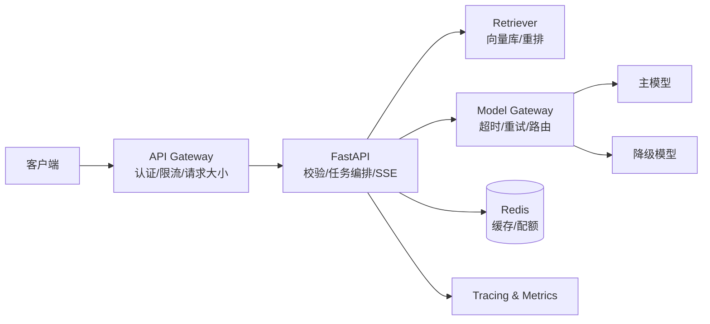
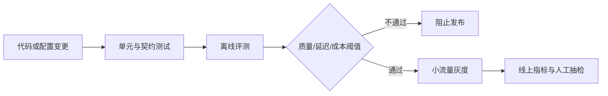

+++
date = '2026-10-05T17:00:00+08:00'
draft = false
title = 'LLM 应用服务生产化：FastAPI、流式输出与限流降级'
tags = ["AI", "LLM", "FastAPI", "工程化"]
categories = ['AI 技术笔记']
description = "把能运行的 LLM Demo 变成可上线服务：FastAPI 异步接口、SSE 流式输出、Docker 健康检查、超时重试、限流降级、Tracing、Token 成本监控与回归发布门禁。"
+++

## Demo 与生产服务差在哪里

Demo 只需证明模型能回答；生产服务还要回答以下问题：

- 上游模型超时、限流或返回异常时，用户会看到什么？
- 100 个请求同时到来时，服务会排队、拒绝还是拖垮进程？
- 一次回答经过了哪些检索、模型和工具调用，如何定位慢在哪里？
- Prompt 或模型升级后，效果退化能否在发布前发现？
- 每个请求消耗多少 Token，成本异常能否及时告警？

生产化的核心不是增加框架，而是为延迟、容量、质量、安全和成本建立明确边界。

## 推荐的服务边界



API 层不应直接散落厂商 SDK 调用。通过 Model Gateway 统一模型名称、超时、重试、Token 统计和错误类型，才能在不改业务代码的情况下切换供应商。

## FastAPI：请求模型与依赖边界

先把输入限制写进 schema，避免超长问题和不受控参数进入下游：

```python
from typing import Literal
from fastapi import FastAPI, Depends
from pydantic import BaseModel, Field

app = FastAPI(title="LLM Application API")

class ChatRequest(BaseModel):
    question: str = Field(min_length=1, max_length=2000)
    conversation_id: str = Field(min_length=8, max_length=64)
    mode: Literal["fast", "quality"] = "fast"

@app.post("/v1/chat")
async def chat(
    request: ChatRequest,
    user=Depends(require_user),
    service=Depends(get_chat_service),
):
    return await service.answer(request=request, user=user)
```

建议同时限制：HTTP body 大小、文件类型、文件数量、历史轮数和单次检索文档数。限制越靠近入口，失败成本越低。

## SSE 流式输出：要传事件，不只传文本

Server-Sent Events 适合服务器单向持续输出。事件需要区分正文、引用、用量和错误，客户端才能稳定处理：

```python
import json
from fastapi.responses import StreamingResponse

async def event_stream(service, request, user):
    try:
        async for event in service.stream(request, user):
            payload = json.dumps(event.data, ensure_ascii=False)
            yield f"event: {event.type}\ndata: {payload}\n\n"
    except ClientVisibleError as exc:
        payload = json.dumps({"code": exc.code}, ensure_ascii=False)
        yield f"event: error\ndata: {payload}\n\n"

@app.post("/v1/chat/stream")
async def stream_chat(request: ChatRequest, user=Depends(require_user)):
    return StreamingResponse(
        event_stream(get_chat_service(), request, user),
        media_type="text/event-stream",
        headers={"Cache-Control": "no-cache", "X-Accel-Buffering": "no"},
    )
```

还要处理客户端断开：及时取消模型生成和检索任务，否则用户已离开，后台仍在持续消耗 Token。

## 超时、重试与幂等

不同调用设置不同预算，而不是使用一个全局超时：

| 环节 | 建议策略 |
|------|----------|
| Embedding | 短超时；批量失败可拆批重试 |
| 向量检索 | 短超时；失败时允许退化为关键词检索 |
| Reranker | 中等超时；失败时保留原召回排序 |
| LLM 首 Token | 独立监控 TTFT；超时可切换备用模型 |
| 工具调用 | 每个工具独立超时；禁止无限递归重试 |

只重试瞬时故障，如 429、连接重置和部分 5xx。参数错误、鉴权失败、上下文超限不能重试。写操作必须携带幂等键，防止 Agent 重试造成重复下单或重复提交。

```python
@retry(
    retry=retry_if_exception_type((RateLimitError, UpstreamUnavailable)),
    wait=wait_random_exponential(min=0.5, max=8),
    stop=stop_after_attempt(3),
)
async def call_model(request):
    async with asyncio.timeout(20):
        return await gateway.complete(request)
```

## 限流、并发与背压

限流至少分三层：

1. 用户维度：每分钟请求数与每日 Token 配额；
2. 服务维度：进程内并发信号量，保护连接池和内存；
3. 上游维度：按模型供应商的 RPM/TPM 做集中配额。

当并发达到上限时，应快速返回 `429` 和 `Retry-After`，而不是让请求无限排队。流式请求会长期占用连接，并发预算需要单独计算。

## 降级顺序必须预先定义

以 RAG 问答为例，可按影响从小到大降级：

1. Reranker 超时：使用原始召回排序；
2. 向量库异常：切到关键词检索；
3. 主模型限流：切到兼容的备用模型；
4. 检索链路整体失败：明确提示暂时无法查询，不让模型凭参数记忆回答；
5. 系统过载：拒绝新请求，保护已进入执行的请求。

降级结果必须在响应元数据和日志中标记，避免把降级答案混入正常质量统计。

## Prompt Injection 与数据边界

RAG 中的文档内容是不可信输入。系统需明确：

- 文档里的“忽略之前指令”只能作为资料，不能改变系统策略；
- 工具权限由服务端身份控制，不能由模型输出决定；
- 检索结果在进入模型前标注来源边界；
- 输出引用必须能映射回真实文档与片段；
- 日志默认脱敏，不记录密钥、完整用户文档和敏感回答。

对具有副作用的工具采用“模型提议—代码校验—用户确认—执行”流程。

## Tracing：一次请求要能完整回放

为每个请求生成 `trace_id`，并将以下 span 串起来：

```text
HTTP request
  ├─ query_rewrite
  ├─ retrieve
  │   └─ rerank
  ├─ prompt_build
  └─ model_stream
```

每个 span 记录模型/索引版本、耗时、输入输出长度、重试次数和错误码。正文只保留哈希或脱敏摘要。关键指标包括：

- QPS、成功率、P50/P95/P99 延迟；
- TTFT、生成速度、超时率、重试率；
- Recall@K、Faithfulness、拒答率和用户重问率；
- 输入/输出 Token、缓存命中率和单次请求成本；
- 降级率以及各降级路径的质量差异。

## Docker 与健康检查

镜像使用非 root 用户，依赖固定版本，并区分存活与就绪探针：

```dockerfile
FROM python:3.12-slim
WORKDIR /app
COPY requirements.txt .
RUN pip install --no-cache-dir -r requirements.txt \
    && useradd --create-home appuser
COPY app ./app
USER appuser
EXPOSE 8000
CMD ["uvicorn", "app.main:app", "--host", "0.0.0.0", "--port", "8000"]
```

- `/health/live`：进程可响应即可，不探测外部服务；
- `/health/ready`：检查必要配置、连接池和关键依赖是否可用；
- 不把模型 API Key 写进镜像或仓库，通过部署环境注入。

## 评测进入发布门禁

每次修改 Prompt、模型、Embedding、分块或检索参数，都应运行固定回归集：



门禁不要只看平均分。需要关注关键场景最低分、不可回答问题的幻觉率和 P95 延迟。灰度阶段同时保留旧版本，出现质量或成本异常时能够快速回滚。

## 面试回答框架

被问“如何把 LLM Demo 上线”时，可以按这个顺序回答：

1. 先定义 SLO：质量、P95 延迟、可用性和单次成本；
2. 用 FastAPI + Model Gateway 隔离业务与供应商；
3. 入口做认证、校验、限流和并发保护；
4. 调用链设置超时、有限重试、幂等和逐级降级；
5. 用 Trace、指标和脱敏日志保证可观测；
6. 用固定评测集、灰度与回滚保证变更安全；
7. 对 Prompt Injection、工具副作用和数据泄漏建立硬边界。

## 延伸阅读

- [LLM 应用评估体系：从评测集设计到 LLM-as-a-Judge](/posts/ai_notes/llm_evaluation_system/)
- [AI Agent 工作流实战：用 LangGraph 编排多步推理与工具调用](/posts/ai_notes/agent_workflow_langgraph/)
- [企业知识库问答系统](/projects/knowledge_base_rag/)
