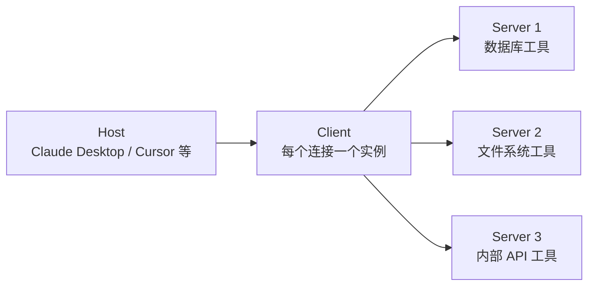

+++
date = '2026-10-05T13:00:00+08:00'
draft = false
title = 'MCP 协议入门与实战：给 AI 应用接上标准化的插头'
tags = ["AI", "MCP", "Agent"]
categories = ['AI 技术笔记']
description = "Model Context Protocol 解决什么问题、Host/Client/Server 三层架构、Resources/Tools/Prompts 三种原语、stdio 与 Streamable HTTP 传输，以及用 Python SDK 写一个自己的 MCP Server 的完整流程。"
+++

## 从「N×M 集成问题」说起

每个 AI 应用都要接外部能力：查数据库、读文件、调内部 API。传统做法是**一对一写集成代码**：N 个 AI 应用 × M 个外部系统 = N×M 份适配代码。每接一个新系统，所有应用都要改。

MCP（Model Context Protocol）做的事情和 USB 一样：**定义统一的插头标准**。外部系统只要实现一次 MCP Server，所有支持 MCP 的 AI 应用（Claude Desktop、Cursor、各类 Agent 框架）都能直接接入，集成成本从 N×M 降到 N+M。

本文衔接 Agent 工具调用的话题（见[AI Agent 工作流实战](/posts/ai_notes/agent_workflow_langgraph/)），梳理 MCP 的架构与实战写法。

## 三层架构：Host / Client / Server



| 角色 | 职责 | 例子 |
|------|------|------|
| Host | AI 应用本体，负责 UI、模型调用、权限确认 | Claude Desktop |
| Client | 与某个 Server 的一对一连接，管理会话 | SDK 内部创建 |
| Server | 暴露能力（工具/资源/提示词）的服务 | 数据库 MCP Server |

一个 Host 可以同时连接多个 Server，Agent 按需从不同 Server 取工具——这就是「生态」的含义：**工具不再由应用开发者写死，而是像安装插件一样接入**。

## 三种原语：Tools / Resources / Prompts

Server 暴露的能力分三类：

| 原语 | 语义 | 类比 |
|------|------|------|
| Tools | 可执行的动作，由模型决定何时调用 | Function Calling 的工具 |
| Resources | 可读取的数据，用 URI 标识 | 只读数据源 |
| Prompts | 预置的提示词模板 | 快捷指令 |

```python
# 一个最小 MCP Server（官方 Python SDK）
from mcp.server.fastmcp import FastMCP

mcp = FastMCP("库存查询服务")

@mcp.tool()
def query_stock(product_name: str) -> str:
    """查询商品库存。当用户询问某商品是否有货时使用。"""
    # 这里接真实库存数据库
    return f"{product_name}：现货 128 件，预计补货 10-12"

@mcp.resource("stock://hot")
def hot_products() -> str:
    """返回当前热销商品列表（只读数据）。"""
    return "热销榜：蓝牙耳机、机械键盘、显示器支架"

if __name__ == "__main__":
    mcp.run()  # 默认 stdio 传输
```

要点：`@mcp.tool()` 的 docstring 就是给模型看的工具描述——和 Function Calling 一样，**描述决定调用准确率**（见[Function Calling 实战](/posts/ai_notes/function_calling_practice/)）。

## 传输层：stdio 与 Streamable HTTP

| 传输方式 | 适用场景 | 特点 |
|---------|---------|------|
| stdio | 本地进程，Host 拉起 Server 子进程 | 简单、无网络暴露 |
| Streamable HTTP | 远程服务、多用户共享 | 支持鉴权、分布式部署 |

本地开发用 stdio 起步即可；生产环境要共享给多用户时，改用 Streamable HTTP 并加上鉴权。

## 实战：从零写一个可用的 MCP Server

完整流程五步：

1. **定义能力边界**：这个 Server 暴露哪些工具？每个工具的输入输出？
2. **实现工具函数**：写好 docstring（触发条件 + 参数说明）
3. **跑通 stdio 调试**：用 MCP Inspector（官方调试工具）手动调用验证
4. **配置到 Host**：在 Host 的配置里注册 Server 启动命令
5. **加安全防护**：参数校验、超时、调用日志

```json
// Claude Desktop 的 mcp 配置示例（claude_desktop_config.json）
{
  "mcpServers": {
    "inventory": {
      "command": "python",
      "args": ["-m", "inventory_mcp"],
      "env": {"DB_URL": "..."}
    }
  }
}
```

## 安全：MCP 的雷区

MCP 本质是给模型「操作系统权限」，安全边界必须自己画：

- **最小权限**：Server 只暴露完成任务所需的最少工具；数据库 Server 拒绝 DELETE 类工具
- **敏感操作要确认**：Host 侧的「人类审批」机制，写操作弹确认
- **防提示注入**：工具返回的外部内容（网页、文档）可能携带「忽略之前指令」的注入文本，进入上下文前要清洗或标记（见 GraphRAG 文中 Text2Cypher 的白名单思路）
- **参数校验在 Server 侧**：不信任模型传参，路径参数防目录穿越

## 生态现状与面试要点

生态状态：主流 IDE（Cursor、Windsurf）、Agent 框架（LangChain、LlamaIndex）、云厂商都已支持 MCP；社区有数千个现成 Server（数据库、浏览器、GitHub 等），类似「工具版的 npm」。

面试要点速记：

- MCP 解决的核心问题：工具集成的 N×M 复杂度 → N+M
- 三层架构职责：Host（应用）/ Client（连接）/ Server（能力）
- 三种原语：Tools（动作）/ Resources（数据）/ Prompts（模板）
- 两种传输：stdio（本地）/ Streamable HTTP（远程）
- 安全三件套：最小权限、敏感操作确认、防提示注入

## 延伸阅读

- [AI Agent 工作流实战：用 LangGraph 编排多步推理与工具调用](/posts/ai_notes/agent_workflow_langgraph/)
- [Function Calling 与结构化输出实战：让 LLM 的输出可编程](/posts/ai_notes/function_calling_practice/)
- [Codex 编程 Agent 实战](/posts/ai_notes/codex_coding_agent/)
