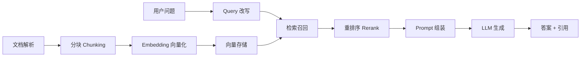
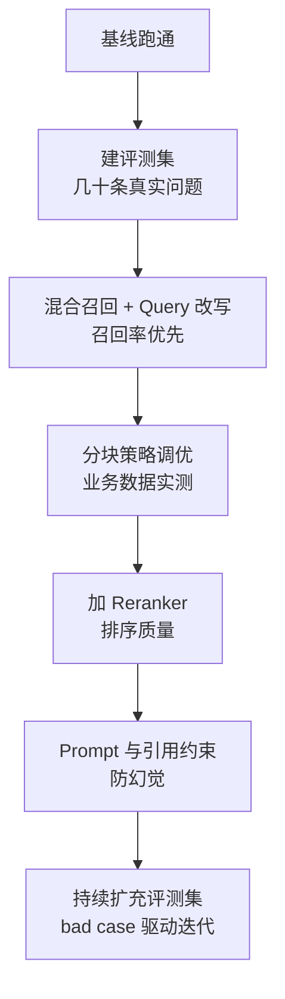

+++
date = '2026-10-05T09:00:00+08:00'
draft = false
title = 'RAG 优化实战：从「能跑」到「能用」的系统调优路线图'
tags = ["AI", "RAG", "LangChain"]
categories = ['AI 技术笔记']
description = "把 RAG 系统从 demo 调到生产可用，需要按链路拆解逐一优化：解析、分块、Embedding、检索、重排、生成，以及最容易被忽略的评测体系。"
+++

## 为什么「能跑」离「能用」还很远

搭一个 RAG demo 只需要半天：文档切块 → 向量化 → 存库 → 提问时召回 Top-K → 塞给 LLM 生成答案。但 demo 的问题在于：**它对「正常问题」有效，对「真实问题」翻车**。

真实用户的问题可能是缩写、口语、多轮追问、跨文档组合，甚至是一句病句。RAG 系统上线后最常见的反馈是：「有时候答得不错，有时候像在胡扯」。

本文按 RAG 全链路拆解每一环的常见问题与优化手段，并结合我在企业知识库问答项目中的实践（见[项目详情](/projects/knowledge_base_rag/)），给出一个可执行的优化路线图。

## 链路全景



优化 RAG 的第一性原理：**检索质量决定了生成质量的上限**。LLM 只能基于检索到的上下文回答，召回错了，生成再强也没用。所以优化的重心在「解析 → 检索」这一段。

## 第一环：文档解析

**常见问题**：

- PDF 扫描件没有文本层，需要 OCR，而 OCR 质量直接影响下游
- 双栏排版的 PDF，按行提取会把左右栏混在一起
- 页眉、页脚、页码、水印混入正文，污染分块
- 表格被解析成一堆零散数字，语义全丢

**优化手段**：

1. 优先选择带结构信息的解析库（如 pdfplumber 保留坐标信息，可以按版面分栏提取）
2. 解析层就做清洗：去页眉页脚、去页码、合并被截断的句子
3. 表格单独处理：转成 Markdown 表格或描述性文本，保证 LLM 能理解行列关系
4. 建立解析质量抽查机制——分块前的错误，检索层永远救不回来

## 第二环：分块策略

分块是 RAG 里性价比最高的调优点之一。三种主流策略：

| 策略 | 做法 | 适用场景 |
|------|------|----------|
| 固定长度 | 按 token 数硬切 + overlap | 通用文本，快速起步 |
| 层级分块 | 按标题/段落结构切 | 有结构的文档（手册、制度、报告） |
| 语义分块 | 按语义相似度切分点 | 结构弱的文本（聊天记录、流水文本） |

**核心矛盾**：块太小 → 语义割裂，检索到的片段看不懂；块太大 → 噪音多，LLM 被无关内容干扰。没有银弹，只能通过**业务评测集**实测。

我的实践经验：企业文档场景下，300~500 token 的层级分块 + 15% overlap 是甜点区；overlap 的关键是保证「一个完整概念至少完整出现在一个块里」。

## 第三环：Embedding 选型

选 Embedding 模型，榜单只能做初筛，**必须用业务数据实测**：

- 中文场景优先选中文优化模型，MTEB 高分英文模型可能水土不服
- 业务术语多（缩写、行话）时，考察模型对领域词的区分度
- 维度与成本的权衡：768 维的通用模型 vs 1024+ 维的新模型，存储和检索延迟都有差异
- 考虑是否支持 Matryoshka（可截断维度），方便后期降维

一个实用技巧：**用真实 FAQ 对做召回评测**——把「问题-标准答案文档」配对，测 Top-1/Top-5 召回率，几分钟就能跑完几十个模型。

## 第四环：检索召回

**向量检索的两个经典问题**：

1. **语义漂移**：query 和文档用词不同但语义相近时，向量检索比关键词检索好；但缩写、型号、专有名词这类「硬匹配」，向量检索反而不如 BM25
2. **固定 Top-K 不适配所有问题**：事实类问题 3~5 个块就够，综述类问题可能需要 10+ 个

**优化手段（按收益排序）**：

1. **混合召回**：向量检索 + BM25 关键词检索，用 RRF（Reciprocal Rank Fusion）融合。几乎零成本，召回率普遍有 10%+ 的提升
2. **Query 改写**：多轮对话的追问先做指代消解（「它的配置呢？」→「XX 产品的配置」）；口语化表达归一化
3. **动态 Top-K**：先让 LLM 判断问题类型（事实/综述/对比），再决定召回数量
4. **元数据过滤**：如果文档有来源、部门、日期等元数据，先过滤再检索，既快又准

## 第五环：重排序

重排序解决「召回回来了，但排序不对」的问题。向量相似度 ≠ 语义相关性，BGE-reranker、Cohere Rerank 这类交叉编码器模型能显著改善排序质量。

**实践建议**：

- 召回 20~50 个候选，重排后取前 3~5 个进 Prompt，是常见的「宽召回、精排序」配置
- 重排模型的成本远低于召回模型，但延迟会增加，权衡点在于把重排放在召回之后、生成之前
- 重排是「加一层」而不是「换一层」：它解决排序问题，解决不了召回为空的问题

## 第六环：生成

生成环节的优化主要是 Prompt 工程：

1. **强约束引用**：System Prompt 明确「只依据提供的上下文回答，上下文没有的信息明确说不知道」，并把来源编号写进要求
2. **结构化输出**：要求带引用编号的答案格式（如 `[1][2]`），既防幻觉又能溯源
3. **温度控制**：知识问答类场景用低温度（0~0.3），保证答案稳定性
4. **兜底策略**：检索结果为空或相似度过低时，走「我不知道」分支而不是硬答

## 最容易被忽略的第七环：评测体系

没有评测，所有优化都是玄学。**最小可用评测集**只需要几十条：

```
问题 | 标准答案文档 | 期望来源页码
```

每次调参（chunk size、Top-K、Prompt、模型）后跑一遍，用三个指标跟踪：

- **召回率**：标准文档是否在 Top-K 里
- **答案准确率**：LLM 回答是否正确（可先用 LLM-as-judge 粗评，关键问题人工复核）
- **引用准确率**：答案引用的来源是否真的包含答案

评测集要随线上 bad case 持续扩充——**线上用户的问题是最好的评测数据**。

## 优化路线图总结



每个阶段都以评测指标为准绳，而不是凭感觉。RAG 的优化没有终点，只有「评测驱动的持续迭代」。

---

**延伸阅读**：

- [企业知识库问答系统（项目实战）](/projects/knowledge_base_rag/)
- [RAG 分块可视化工具（交互演示 chunk size / overlap 的影响）](/tools/rag_chunking_visualizer/)
