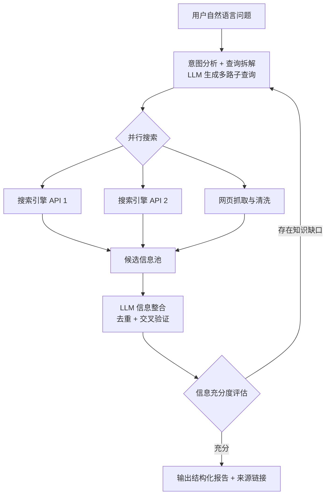

+++
date = '2026-08-26T10:00:00+08:00'
draft = false
title = 'AI 深度搜索'
tags = ["AI", "Agent", "LangGraph"]
categories = ['项目实战']
description = "结合搜索引擎与大语言模型的 AI 深度搜索工具，通过查询改写、多源信息整合与 LLM 总结，实现结构化的深度信息检索。"
pinned = true
+++

## 项目概述

AI 深度搜索是一个基于 LLM Agent 的智能搜索增强工具。传统搜索引擎返回的是链接列表，用户需要逐一点击、阅读、提炼。本项目通过 LLM 理解用户意图，自动改写查询、调用搜索引擎获取多源结果，再由 LLM 进行信息整合与结构化总结，最终输出可直接使用的深度分析报告。

**一句话定位**：把「搜 → 点 → 读 → 总结」的人工流程，变成一次提问直接得到带来源的深度分析报告。

## 技术架构



**核心技术栈**：LangGraph + OpenAI API + 搜索引擎 API + Python

> 项目定位：个人 Agent 工程实践。本文展示工作流、容错和成本边界设计；在固定任务集与可复现运行环境公开前，不展示脱离测试条件的性能数字。

## 工作流状态设计

核心状态只保留可驱动后续节点的字段，原始网页正文不在图中反复传递，避免状态膨胀：

```python
class SearchState(TypedDict):
    question: str
    sub_queries: list[str]
    evidence: list[Evidence]
    gaps: list[str]
    iteration: int
    errors: list[ToolError]
    report: str | None
```

- **终止条件**：达到信息充分度阈值，或触发最大迭代轮数/Token 预算任一硬限制。
- **并行策略**：子查询有界并发；每个工具独立超时、重试和记录错误，不因单点失败丢弃整轮结果。
- **恢复策略**：节点输出持久化为 checkpoint，失败后从最近成功节点恢复，而不是重跑完整任务。
- **可观测性**：每个节点记录输入摘要、耗时、模型/工具名称、Token 用量和错误类型。

## 核心功能

### 1. 智能查询改写
将用户的模糊问题拆解为多个精准的搜索子查询。例如用户问"2026年最值得学习的AI方向"，系统自动拆解为"AI 热门方向 2026"、"AI 岗位需求趋势"、"AI 学习资源推荐"等多个子查询，提升搜索覆盖率。

### 2. 多源信息检索
并发调用搜索引擎 API，从多个来源获取搜索结果。对返回的网页进行内容抓取与清洗，提取核心文本，过滤掉广告、导航等噪音信息。

### 3. 信息整合与总结
将多源检索结果统一喂给 LLM，由 LLM 进行交叉验证、去重、整合，生成结构化的深度分析报告。报告包含核心结论、分点论述、数据支撑和来源引用。

### 4. 迭代深化搜索
对于复杂问题，系统支持多轮迭代搜索——第一轮搜索后评估信息充分度，若发现知识缺口，自动补充新的子查询进行第二轮搜索，逐步完善答案。

## 难点与解决

| 难点 | 问题表现 | 解决方案 |
|------|----------|----------|
| 单轮搜索覆盖不足 | 复杂问题一次搜索只能覆盖部分角度，答案片面 | 查询拆解 + 迭代深化：首轮搜索后评估信息缺口，自动补搜 |
| 搜索并发控制 | 串行调用搜索 API 耗时过长，全并发又容易触发限流 | 有界并发（信号量控制并发数），失败重试 + 退避 |
| 网页内容噪音 | 抓取的网页含广告、导航、脚本等噪音，污染 LLM 输入 | 正文提取算法（基于标签密度/文本密度），清洗后截取核心段落 |
| 信息矛盾 | 多源信息互相矛盾（如不同网站数据不一致） | LLM 交叉验证 + 标注信息一致性，矛盾内容显式标记并保留多方观点 |
| 无限迭代风险 | 迭代搜索缺少终止条件，可能陷入死循环 | 设置最大迭代轮数 + 信息充分度评分阈值，双条件终止 |

## 踩坑复盘

1. **LangGraph 状态管理是双刃剑**。图的状态越复杂，调试越困难。早期把所有中间结果塞进 state，单步排查时噪音巨大；后来精简状态结构，只保留必要字段，可观测性大幅提升。
2. **搜索 API 限流比想象中频繁**。全并发调用会在几秒内触发限流，串行又太慢。最终确定有界并发 + 指数退避的组合，稳定性和速度平衡最好。
3. **「信息充分度」的评估 Prompt 很关键**。评估太宽松 → 报告浅；太严格 → 无限补搜。经过多轮 Prompt 调优，让 LLM 按「事实覆盖度 / 来源多样性 / 时效性」三个维度打分，行为才稳定下来。
4. **LLM 输出需要结构化约束**。早期让 LLM 自由输出报告，格式不稳定、解析困难；改用 JSON Schema / 结构化输出后，下游处理和展示都简单了。
5. **成本意识**。迭代搜索每次补搜都要消耗 token，控制最大轮数和每轮子查询数量，对成本影响很大。做 Agent 项目，成本边界要提前设计。

## 验证范围与成果

当前验证重点是查询拆解、并行检索、证据去重、充分度判断、循环终止和结构化报告生成。后续公开评测将使用固定任务集记录任务完成率、平均迭代轮数、端到端延迟、Token 消耗和单次成本，并保留失败 Trace 供回归分析。

**已形成的工程产出**：

- 实现了从"搜索链接列表"到"直接给出深度分析"的体验升级
- 掌握了 LangGraph 状态管理、节点调度、条件分支等 Agent 工作流编排能力
- 验证了「LLM + 工具调用」的可行性，为后续更复杂的 Agent 系统打下基础

## 公开状态

可复现仓库与脱敏 Trace 仍在整理。当前可先参考配套文章：[LangGraph Agent 工作流实战](/posts/ai_notes/agent_workflow_langgraph/)与[Function Calling 实战](/posts/ai_notes/function_calling_practice/)。
