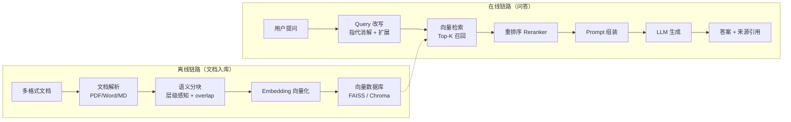

+++
date = '2026-08-25T12:00:00+08:00'
draft = false
title = '企业知识库问答系统'
tags = ["AI", "RAG", "LangChain"]
categories = ['项目实战']
description = "基于 LangChain 构建的企业级 RAG 知识库问答系统，支持多格式文档解析、向量检索与智能问答。"
pinned = true
+++

## 项目概述

企业知识库问答系统是一个基于 RAG（Retrieval-Augmented Generation）架构的智能问答平台，面向企业内部文档管理场景。用户可上传多种格式的企业文档（PDF、Word、Markdown 等），系统自动完成文档解析、分块、向量化存储，并通过大语言模型实现精准的知识检索与自然语言问答。

**一句话定位**：让员工用自然语言提问，直接得到带来源引用的答案，替代「翻文档 + 问同事」的传统找资料方式。

## 技术架构

**核心技术栈**：LangChain + 向量数据库（FAISS / Chroma）+ OpenAI API + Python

> 项目定位：个人 RAG 工程实践。本文重点展示架构设计、关键取舍与复盘；在公开评测集、运行环境和复现仓库完善前，不展示未经验证的性能数字。

## 核心功能

### 1. 多格式文档解析
支持 PDF、Word、Markdown、TXT 等企业常见文档格式的自动解析与文本提取，针对不同格式采用专门的 Loader 策略，确保表格、标题层级等结构化信息不丢失。

### 2. 智能文档分块（Chunking）
采用语义感知的分块策略，而非简单的固定长度切分。根据文档结构（标题、段落）进行层级分割，同时设置合理的 chunk overlap，避免关键信息在切分边界处被截断。

### 3. 向量检索与召回
将文档块通过 Embedding 模型转化为高维向量，存入向量数据库。用户提问时，先对 query 进行向量化，再通过相似度检索（如 cosine similarity）召回 Top-K 相关文档块。

### 4. 多轮对话支持
基于对话历史维护上下文记忆，支持追问、澄清、多轮交互等真实对话场景，让问答体验更接近人类对话。

### 5. 答案溯源
生成的答案附带来源文档引用，用户可点击查看原始文档段落，确保答案的可验证性和可信度。

## 生产化设计边界

项目按“API 层—检索层—模型网关—观测层”拆分，避免业务逻辑直接依赖某一家模型 SDK：

- **API 层**：FastAPI 校验问题长度、文件类型和历史轮数，流式响应输出正文、引用与错误事件。
- **检索层**：向量召回、BM25 与 Reranker 分别设置超时；重排失败时可退化为原召回排序。
- **模型网关**：统一模型名称、超时、有限重试、Token 统计和错误码，支持主备模型切换。
- **安全边界**：检索文档视为不可信输入；Prompt Injection 不得改变系统策略，具有副作用的工具需要代码校验与用户确认。
- **可观测性**：按 `trace_id` 关联查询改写、召回、重排和生成，记录版本、耗时、Token 与降级路径，不记录敏感原文。
- **部署边界**：Docker 镜像使用非 root 用户，存活探针与就绪探针分离，密钥仅从部署环境注入。

完整实现要点见[LLM 应用服务生产化](/posts/ai_notes/llm_service_production/)。

## 难点与解决

| 难点 | 问题表现 | 解决方案 |
|------|----------|----------|
| 表格与列表被切碎 | 固定长度切分把表格拦腰截断，检索到的 chunk 残缺，LLM 无法理解 | 按文档层级（标题/段落/表格）结构化分块，表格作为一个完整单元保留 |
| 检索结果不相关 | 语义向量对业务术语（缩写、同义词）不敏感，召回率低 | Query 改写 + 同义词扩展；引入关键词检索（BM25）与向量检索混合召回 |
| 幻觉回答 | LLM 有时脱离检索上下文编造信息 | System Prompt 强约束「只依据提供的上下文回答」，无依据时明确说不知道；答案溯源功能兜底 |
| 多轮追问指代不清 | 「它的退款流程呢？」中的「它」无法定位到上一轮的文档 | 对话历史压缩 + 指代消解改写，把追问改写为完整独立问题再检索 |

## 踩坑复盘

1. **「分块越大越好」是误区**。早期用 1000+ token 的大块，检索到的上下文噪音大，LLM 回答反而变差；后来通过评测对比发现，本场景下 300~500 token 的层级分块 + 15% overlap 效果最佳。
2. **Embedding 模型不能只看榜单**。某个榜单分数很高的模型对中文业务文档效果一般，换用针对中文优化的模型后，召回率明显提升。选型必须以业务数据实测为准。
3. **Top-K 不是越大越好**。K 值过大时无关上下文占比上升，LLM 容易被噪音带偏。针对不同问题类型（事实类/综述类）动态调整 K 值收益明显。
4. **PDF 解析是重灾区**。扫描件 PDF 的 OCR 质量、双栏排版的阅读顺序、页眉页脚噪音，都会直接污染分块质量，需要在解析层做清洗而不是在检索层补救。
5. **评测要尽早建立**。没有评测集之前，每次调参数（chunk size、K 值、Prompt）都靠感觉，改完不知道是变好还是变坏；建立几十条带标准答案的评测集后，迭代才有方向。

## 验证范围与成果

当前已验证文档解析、结构化分块、向量检索、查询改写、重排序与来源引用等关键链路。下一轮公开评测将固定模型版本、测试环境和脱敏问题集，分别记录 Recall@K、Faithfulness、端到端延迟与单次调用成本，避免脱离测试条件展示数字。

**已形成的工程产出**：

- 打通了从文档解析 → 分块 → 检索 → 生成的完整 RAG 工程链路
- 形成了分块策略、混合召回与重排序的逐项对比路径，可在固定评测集上做回归验证
- 积累了 RAG 系统评测方法，为后续所有检索类项目提供了可复用的评测框架

## 公开状态

项目页持续补充可复现代码、脱敏评测集与运行截图；当前可先参考配套文章：[RAG 优化实战](/posts/ai_notes/rag_optimization_in_practice/)与[LLM 应用评估体系](/posts/ai_notes/llm_evaluation_system/)。
