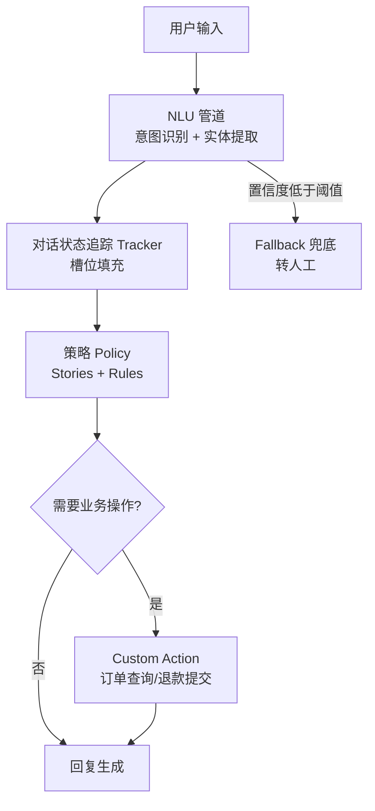

+++
date = '2026-08-27T10:00:00+08:00'
draft = false
title = 'Rasa 电商客服助手'
tags = ["AI", "NLU", "对话系统"]
categories = ['项目实战']
description = "基于 Rasa 框架构建的电商智能客服助手，支持意图识别、实体提取与多轮对话管理，实现自动化客户服务。"
+++

## 项目概述

电商客服助手是一个基于 Rasa 开源框架的学习项目，面向电商场景验证意图识别、实体提取、槽位管理和规则化多轮对话。项目用于比较传统 NLU 对话系统与 LLM 方案在可控性、成本和泛化能力上的差异，不代表生产部署成果。

**一句话定位**：用可控、可解释的 NLU 对话系统，把高频重复的客服问题自动化。

## 技术架构

**核心技术栈**：Rasa + Python + NLU Pipeline

## 核心功能

### 1. 意图识别（Intent Classification）
通过 Rasa NLU 管道对用户输入进行意图分类，覆盖电商场景的常见意图：查询订单状态、申请退换货、咨询商品信息、投诉反馈等。支持自定义训练数据扩充，持续提升识别准确率。

### 2. 实体提取（Entity Extraction）
从用户输入中自动提取关键业务实体，如订单编号、商品名称、日期范围等。结合正则表达式和模型预测，确保实体识别的准确性和鲁棒性。

### 3. 多轮对话管理
基于 Rasa 的 Stories 和 Rules 机制，编排复杂的对话流程。例如退款流程：确认订单 → 验证退款条件 → 收集退款原因 → 提交退款申请，每一步都有对应的对话节点和异常处理。

### 4. 槽位管理（Slot Filling）
通过 Slot 机制维护对话过程中的关键状态信息（如当前操作的订单号、用户选择的退款方式等），确保跨轮次的信息连贯性。

### 5. 自定义动作（Custom Actions）
对接后端业务系统，实现订单查询、物流跟踪、退款提交等实际操作。通过 Rasa SDK 编写 Python 动作函数，连接数据库和外部 API。

## 难点与解决

| 难点 | 问题表现 | 解决方案 |
|------|----------|----------|
| 口语化表达意图难识别 | 「我那个快递到哪了」与「订单到哪了」是同一意图，但字面差异大 | 扩充同义训练样本 + 数据增强；结合词表与领域词典提升 NLU 泛化 |
| 实体边界模糊 | 「3 天内能到吗」中的时间、「那件黑色的」中的商品描述，边界不清晰 | 正则与模型混合提取：规则兜底格式固定的实体（订单号），模型负责灵活实体 |
| 对话中途意图切换 | 用户查订单时突然问退款，Stories 无法覆盖所有组合 | 意图中断检测 + 槽位保留，设计「切意图不丢上下文」的恢复机制 |
| 兜底体验差 | 低置信度直接转人工，用户流失 | 分级兜底：先尝试澄清追问（「您是想查订单还是退款？」），二次失败才转人工 |

## 踩坑复盘

1. **训练数据质量决定 NLU 上限**。模型和管道调优的收益远不如扩充高质量训练样本来得直接。真实对话日志是最宝贵的训练数据来源，需要建立「日志 → 标注 → 训练 → 评测」的闭环。
2. **Stories 别贪多**。对话路径写得越多越难维护，还容易出现相互矛盾的路径。用 Rules 处理确定性流程（如订单号格式校验），Stories 只覆盖核心对话模式，反而更稳。
3. **置信度阈值要结合业务调**。统一用 0.7 的默认阈值，意图识别漏判和误判都不少。不同意图的重要程度不同（退款投诉要求高精确率，商品咨询可以更宽松），分级阈值效果更好。
4. **与 LLM 的选型对比很值得做**。Rasa 可控性强、成本低、可解释，但泛化能力和多轮自由对话不如 LLM。这个项目的对比经验，直接影响了我后来选择 RAG/Agent 路线的判断。

## 验证范围与成果

当前页面记录的是架构与学习复盘，尚未公开固定数据集、混淆矩阵或线上业务指标，因此不展示准确率和自动化率数字。

**已验证内容**：

- 实现了电商场景下常见客服问题的自动化处理
- 深入理解了传统 NLU 对话系统的架构：意图识别、实体提取、对话状态管理
- 对比了规则型对话系统（Rasa）与 LLM 对话系统在可控性、成本、效果上的差异，为 RAG/Agent 技术选型提供了依据

## 公开状态

当前作为学习项目归档；若后续公开训练数据、配置与评测脚本，将在本页补充复现入口。
