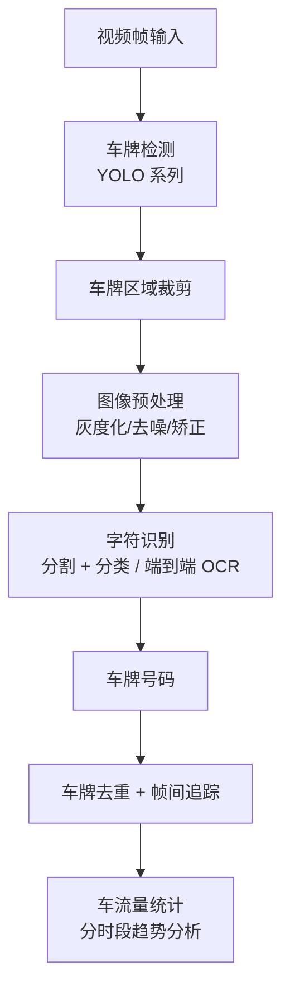

+++
date = '2026-08-28T10:00:00+08:00'
draft = false
title = '车牌识别与车流量统计系统'
tags = ["AI", "计算机视觉", "深度学习"]
categories = ['项目实战']
description = "基于深度学习的车牌识别与车流量统计系统，实现视频流中的车牌检测、字符识别与交通流量分析。"
+++

## 项目概述

车牌识别与车流量统计系统是一个计算机视觉学习项目，面向智能交通场景梳理从车牌检测、字符识别到车辆去重和流量统计的完整处理链路。当前页面重点记录方案设计与工程难点，不代表已在真实交通系统中上线。

**一句话定位**：让摄像头看懂「哪辆车、什么牌、几点经过」，自动生成交通流量分析。

## 技术架构

**核心技术栈**：Python + PyTorch + OpenCV + 深度学习模型

## 核心功能

### 1. 车牌检测（License Plate Detection）
使用目标检测模型（如 YOLO 系列）对视频帧中的车牌区域进行定位。模型经过车牌数据集训练，能够在不同光照、角度和距离条件下准确检测车牌位置。

### 2. 车牌字符识别（License Plate Recognition）
对检测到的车牌区域进行裁剪和预处理（灰度化、二值化、去噪等），然后通过 OCR 模型或字符分割 + 分类的方式识别车牌上的字符序列，支持中文、英文和数字的混合识别。

### 3. 车流量统计
基于车牌识别结果进行车辆去重和计数。通过车牌号码的唯一性，避免同一车辆在多帧中被重复计数。同时支持按时段统计车流量，生成流量趋势图。

### 4. 视频流处理
支持对实时视频流或录像文件进行逐帧处理，实现连续的车辆检测与识别。通过帧间追踪减少重复检测，提升处理效率。

## 难点与解决

| 难点 | 问题表现 | 解决方案 |
|------|----------|----------|
| 小目标检测困难 | 远距离车辆的车牌在画面中只有几十像素，检测框漏检多 | 多尺度训练 + 数据增强；针对小目标调整 anchor 与输入分辨率 |
| 夜间与逆光场景退化 | 低照度下车牌对比度差，字符识别率骤降 | 预处理管线加入直方图均衡/自适应阈值；采集夜间数据补充训练集 |
| 相似字符混淆 | 0/O/D/Q、8/B 等字符极易识别错误 | 车牌先验规则校验（省份简称、字母位规则）+ 后处理纠错 |
| 同车多帧重复计数 | 同一辆车连续多帧被检测，直接计数会虚高 | 车牌 ID 去重 + 帧间 IoU 追踪，同一车牌短时间内只计一次 |
| 推理速度瓶颈 | 逐帧全流程推理速度跟不上实时视频流 | 帧间隔采样 + 检测/识别解耦，仅在检测到车牌时才跑识别分支 |

## 踩坑复盘

1. **数据集是最大的坑**。公开数据集与真实监控画面的域差异很大，直接用公开数据训练的模型上线后效果打折。采集少量真实场景数据做微调，比继续堆公开数据收益大得多。
2. **预处理顺序有讲究**。先矫正再二值化与先二值化再矫正，结果差异明显。倾斜车牌的透视矫正要放在二值化之前，否则字符粘连严重。
3. **车牌先验规则是性价比最高的优化**。中国的车牌有固定格式（省份 + 字母 + 5 位），用规则做后处理校验，几乎零成本就能纠正一批模型误识。
4. **统计口径要明确**。按车牌去重还是按车辆目标去重，结果差异很大。无牌车、摩托车是否计入统计，都需要在需求阶段定义清楚，否则「流量数据」无法对账。
5. **模型轻量化的收益要实测**。剪枝和量化后模型体积明显变小，但精度损失和推理加速的幅度因硬件而异，必须以部署目标平台实测为准。

## 验证范围与成果

当前页面没有公开数据集版本、硬件环境和评测脚本，因此不展示 mAP、字符准确率或推理延迟数字。后续评测需要同时固定检测数据集、OCR 测试集、统计口径与目标设备。

**已形成的实践总结**：

- 梳理了视频场景下车牌检测、字符识别、去重与流量统计的数据流
- 总结了数据域差异、预处理顺序、车牌规则校验和统计口径等关键问题
- 对比了目标检测（YOLO）与 OCR 两类任务的评测维度和误差来源
- 明确了剪枝、量化和边缘部署必须基于目标硬件实测的验证原则

## 公开状态

当前作为方案与学习复盘归档；若后续公开训练配置、数据说明与推理脚本，将在本页补充复现入口。
